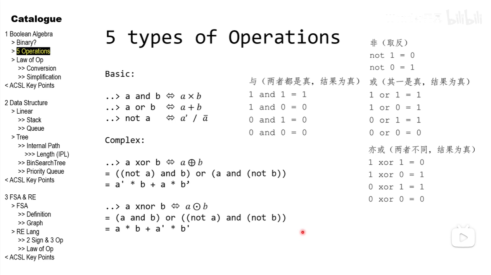

### 算数运算 - 表达式书写规则

- C 语言中的表达式与数学中的表达式在书写格式上是不同的，要遵守以下规则
    - 表达式只能使用系统允许的标识符
      2πr 是错的， `2 * 3.14 * r` 是对的
      或者 `#define` 或 `const`
    - 乘法不能省略，必须写成 `*`
    - c 语言没有分数形式，
    $$
    \frac{a - b}{c + d}
    $$
      必须写成 `(a - b) / (c + d)`
    - 使用括号时，不管有几级，只能使用圆括号 `()`

### 赋值运算符

最简单的运算符：
`变量 = 表达式;`

```c
Height = 177.5;
Weight = 78;
Gender = 'm';
x = a + b;
w = sin(a) + sin(b);
y = i++ - j;
```

### 复合赋值运算符

| 运算符 | 示例 | 等价于 |
| :--- | :--- | :--- |
| `+=` | `x += 5` | `x = x + 5` |
| `-=` | `x -= 5` | `x = x - 5` |
| `*=` | `x *= 5` | `x = x * 5` |
| `/=` | `x /= 5` | `x = x / 5` |
| `%=` | `x %= 5` | `x = x % 5` |


### 赋值表达式的返回值

在 C 语言中，**赋值语句（表达式）的返回值，一定是所赋的值本身**（如果左右类型不同，则是强制转换后的值）。

```c
int a, b, c;
// 链式赋值从右向左执行，c=5 返回 5 给 b，b=5 返回 5 给 a
a = b = c = 5; 

printf("%d\n", a = 5); // 输出 5，因为 (a = 5) 的返回值就是 5
```

### 链式赋值 (Chained Assignment)

C 语言允许将同一个值赋给多个变量，形如 `a = b = c = 5;`。
- **执行顺序**：从右向左结合。先算 `c = 5` 返回 5；再算 `b = 5` 返回 5；最后 `a = 5`。
- **底层机制**：C 语言是将数值**复制**到了不同的内存空间。
- *(拓展)* Python 也支持 `a = b = c = 5`，但本质是三个变量指向内存中的**同一个对象**。如果赋的是可变对象（如 `a = b = []`），修改 `a` 会影响 `b`，需警惕。
- *(拓展)* Python 的赋值语句没有返回值，不能像 C 语言一样写在 `if` 条件中，必须使用海象运算符 `:=`。

@src test

---


### 关系运算符

- 关系运算符是对两个操作数进行大小比较的运算符，其结果为真或假，c 语言中，1 表示真，0 表示假

- 操作数 关系运算符 操作数
关系表达式的计算结果 = 逻辑值（布尔值）

| 运算符 | 含义 |
| :--- | :--- |
| `>` | 大于 |
| `>=` | 大于等于 |
| `<` | 小于 |
| `<=` | 小于等于 |
| `==` | 等于 |
| `!=` | 不等于 |

### 关系表达式举例
已知 a = 3, b = 2, c = 1
1. a > b → 1
2. c > b → 0
3. (a > b) == c → 1
4. d = a > b → 1


### ⚠️ 赋值与条件判断的陷阱

- C 语言条件判断规则：**非 0 值为真，0 值为假**。
- `if (x = 1)`：先把 1 赋给 x，表达式返回 1（真），进入 if 语句。
- `if (x = 0)`：先把 0 赋给 x，表达式返回 0（假），不进入 if 语句。

**新手易错点（小心笔误）：**
本想用 `==` 比较，结果少打一个等号写成了 `=`。这会导致**条件判断的结果被强行锁死**：
- 本想写 `if (x == 1)`，手滑写成了 `if (x = 1)`：此时无论 x 原来是多少，表达式都返回 1，**导致永远为真**，且 x 被强行改成 1。
- 本想写 `if (x == 0)`，手滑写成了 `if (x = 0)`：此时无论 x 原来是多少，表达式都返回 0，**导致永远为假**，且 x 被强行改成 0。

**防错技巧（尤达条件式）：**
把常量写在左边，如 `if (1 == x)` 或 `if (0 == x)`。如果少打一个等号写成 `if (1 = x)`，编译器会直接报错（因为不能给常量赋值），从根源上避免灾难。

**刻意为之：**
如果确实想在条件中赋值并判断，通常会加双括号：`if ((ch = getchar()) != EOF)`。

---

### 逻辑运算符

- 逻辑运算符用于连接一个或者多个条件，判断这些条件的组合是否成立
- 逻辑运算的结果为真（1）或假（0）
- 逻辑运算符的类型为：

| 运算符 | 名称 | 示例 | 说明 |
| :--- | :--- | :--- | :--- |
| `&&` | 逻辑与 (AND) | `a && b` | **两个都为真**时，结果才为真。否则为假。 |
| `\|\|` | 逻辑或 (OR) | `a \|\| b` | **只要有一个为真**，结果就为真。两个都为假才为假。 |
| `!` | 逻辑非 (NOT) | `!a` | **取反**。如果 a 为真，`!a` 为假；如果 a 为假，`!a` 为真。 |

#### 真值表（1为真，0为假）

| a | b | `a && b` | `a \|\| b` | `!a` |
| :--- | :--- | :--- | :--- | :--- |
| 0 | 0 | 0 | 0 | 1 |
| 0 | 1 | 0 | 1 | 1 |
| 1 | 0 | 0 | 1 | 0 |
| 1 | 1 | 1 | 1 | 0 |



#### 短路求值 (Short-Circuit Evaluation)

在 C 语言中，逻辑运算符具有“短路”特性（计算左侧即可决定结果时，右侧不再执行）：

- **`&&` 的短路**：如果左侧为**假 (0)**，则整个表达式必定为假，**右侧的代码不会被执行**。
- **`||` 的短路**：如果左侧为**真 (非0)**，则整个表达式必定为真，**右侧的代码不会被执行**。

```c
int a = 0;
// a != 0 为假，右侧不会执行，b 依然未初始化
if (a != 0 && (b = 10)) { ... } 

int x = 1;
// x == 1 为真，右侧不会执行，y 不会被修改
if (x == 1 || (y = 20)) { ... } 
```

#### 逻辑表达式的真值化
如果参与逻辑运算的操作数不是 0 或 1（比如 5 和 -2），C 语言会先把它们转换为逻辑值（非 0 变 1，0 保持 0），再参与逻辑运算。
例如：`5 && -2`，两边都是非 0（视为真），结果为 1。

### 逻辑表达式举例

例如 int a = 5, b = 3;
1. a > 1 && a < 6 → 1
1. !(a > b) → 0
1. a <= 5 || a >= 10 → 1（短路）
1. a > 6 && b >= 3 → 1（短路）

例1
求下列表达式
6 > 5 && 2 || 7 < 4 - !0
= 1 && 2 || 7 < 4 - 1
= 1 || 7 < 3（其实可以短路了）
= 1 || 0
= 1

例2
表示闰年的条件：应符合下列两个条件之一
1. 能被 4 整除，但不能被 100 整除
2. 能被 400 整除

@src is_leap_year

理论上，可以**牺牲大部分可读性**，简化为下列代码，**但不要滥用**
```c
if ((!(year % 4) && (year % 100)) || !(year % 400)) {
    printf("%d 年是闰年\n", year);
}
```

例 int a = 5; float b = 3.5;
1. !a → 0
1. !b → 0
1. a && b → 1
1. a || b → 1
1. !a && !b → 0


### 小结：运算符优先级

| 优先级 | 运算符 | 结合方向 | 说明 |
| :--- | :--- | :--- | :--- |
| **1 (最高)** | `()` `[]` | 自左向右 | 括号、数组下标 |
| **2** | `!` `++` `--` `sizeof` `(类型)` | **自右向左** | 逻辑非、自增自减、求字节数、强制类型转换 |
| **3** | `*` `/` `%` | 自左向右 | 乘、除、取余 |
| **4** | `+` `-` | 自左向右 | 加、减 |
| **5** | `<` `<=` `>` `>=` | 自左向右 | 关系运算符（大于/小于） |
| **6** | `==` `!=` | 自左向右 | 关系运算符（等于/不等于） |
| **7** | `&&` | 自左向右 | 逻辑与 |
| **8** | `\|\|` | 自左向右 | 逻辑或 |
| **9** | `?:` | **自右向左** | 条件运算符（三目运算） |
| **10 (最低)** | `=` `+=` `-=` `*=` `/=` `%=` | **自右向左** | 赋值运算符 |
| **11** | `,` | 自左向右 | 逗号运算符 |

*(注：C语言中还有一些位运算符如 `&` `|` `^` `<<` `>>`，它们夹在等于和逻辑与之间，考试偶尔考，但日常写业务代码用得少，你需要的话我再给你细补。)*

### 💡 记住这三条铁律，考试就能横着走：
1. **括号最牛逼**：拿不准优先级，就疯狂加 `()`，代码不仅对，而且可读性极高。
2. **单目高于双目，双目高于三目，三目高于赋值**：比如 `!a > b` 相当于 `(!a) > b`；`a > b ? x : y = 10` 相当于 `(a > b ? x : y) = 10`。
3. **只有单目、三目、赋值是“从右向左”结合**，其他绝大多数（算术、关系、逻辑）全是从左向右。

---

### 思考题

试写出下列表达式：
- 判断一个数 n 是奇数还是偶数？
    ```c
    // 偶数： n % 2 == 0
    // 奇数： n % 2 != 0  (严谨写法，避免负数取模问题) 或 n % 2 == 1 （仅正数）
    if (n % 2 != 0) {
        // 是奇数
    } else {
        // 是偶数
    }
    ```
- 判断一个字母 c 是否为英文字符？
    ```c
    if ((c >= 'a' && c <= 'z') || (c >= 'A' && c <= 'Z'))
    ```
- 判断一个年份是否为闰年？
    ```c
    if ((year % 4 == 0 && year % 100 != 0) || (year % 400 == 0))
    ```
- 判断一个数 n 是否被数 k 整除？
    ```c
    if (n % k == 0)
    ```
- 判断三个数是否组成一个三角形
    ```c
    // 任意两边之和大于第三边
    if ((a + b > c) && (a + c > b) && (b + c > a))
    ```